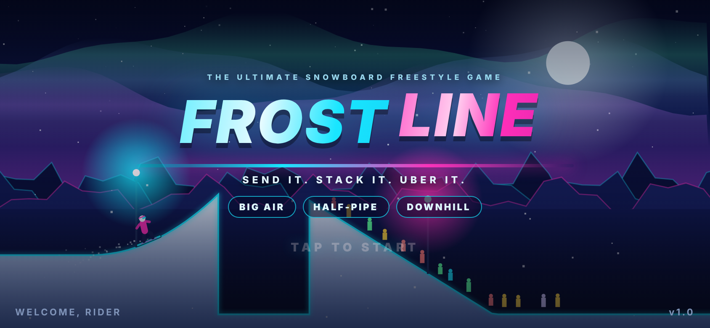
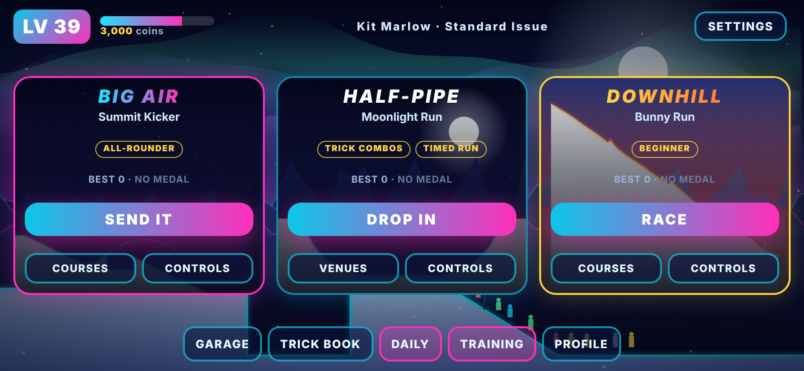
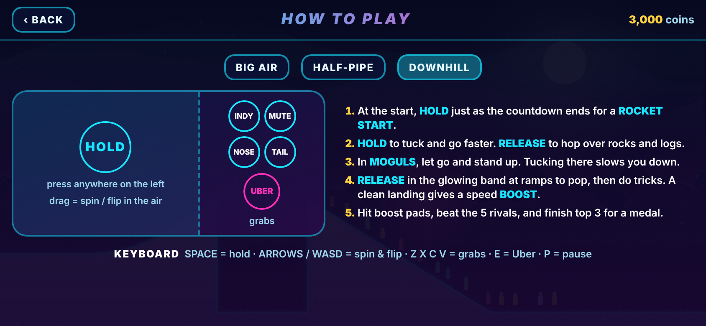
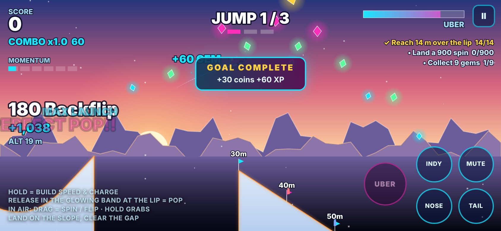
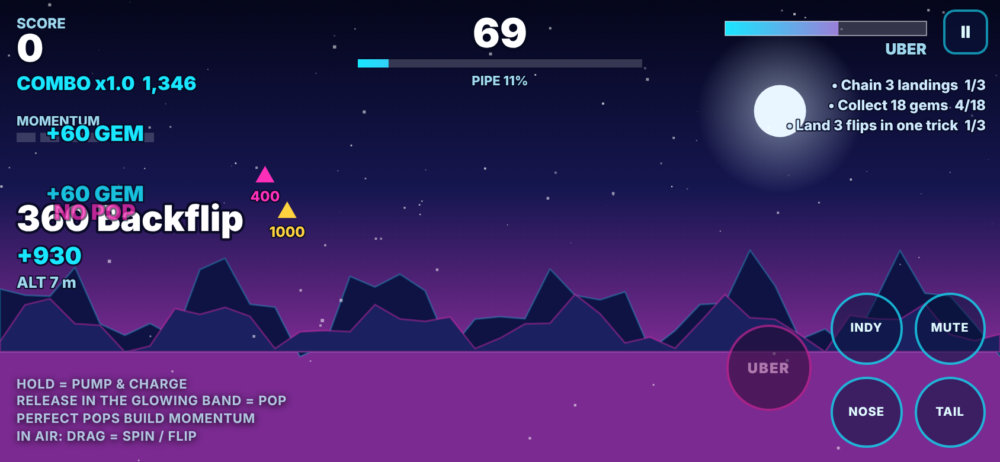
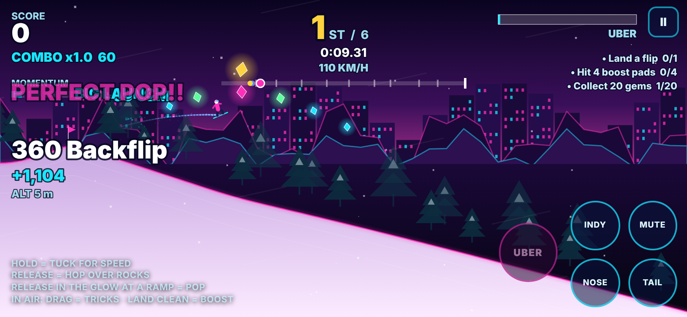
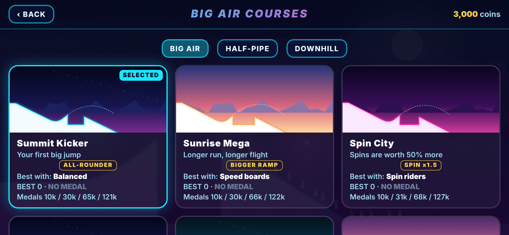
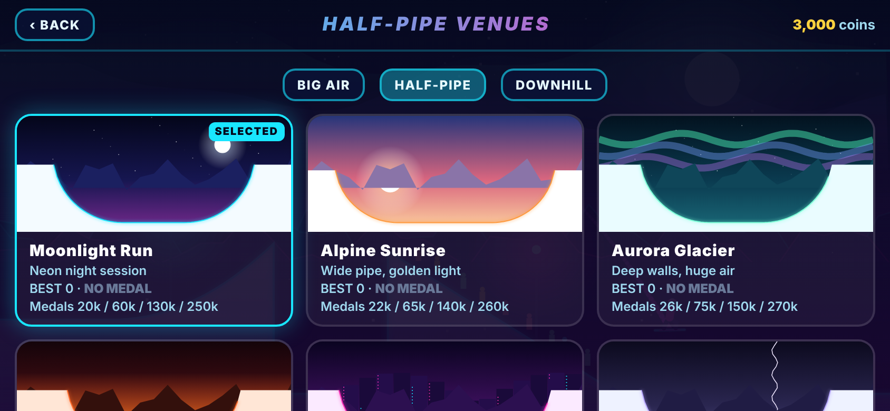
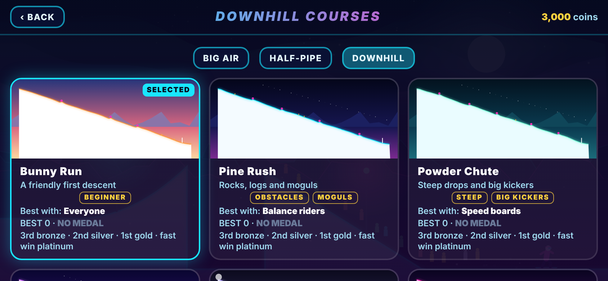

<div align="center">

# FROSTLINE

### Send it. Stack it. Uber it.

**A fast, arcade snowboarding game that runs in your phone's browser — no install, no ads, no accounts.**

Big Air · Half-Pipe · Downhill Racing



</div>

---

## Play

Open the game's GitHub Pages URL on your phone (landscape works best), tap **Share → Add to Home Screen**, and it runs fullscreen and offline like a native app.

Works on any modern browser: iOS Safari, Android Chrome, desktop Chrome/Edge/Firefox/Safari. Everything is stored locally on your device.

## What is Frostline?

Frostline is an SSX-inspired snowboarding game built as a single HTML5 canvas page. It plays in short, addictive runs (about 30–60 seconds) with one-thumb pump-and-pop controls, a deep trick system, and a full progression layer: riders, boards, courses, medals, goals and achievements.

There are three game modes, all sharing the same riders, boards, trick engine and progression:

| Mode | The idea | Content |
|---|---|---|
| **Big Air** | Hit the kicker, clear the gap, stack the biggest trick you can and land it. 3 jumps per run. Distance and clean-landing streaks multiply your score. | 12 courses |
| **Half-Pipe** | Pump the walls, time perfect pops on the lip, build momentum and chain tricks before the clock runs out. | 8 venues |
| **Downhill** | Race five AI riders down the mountain. Tuck for speed, hop obstacles, pop ramps, and land tricks for speed boosts. | 8 courses |





## Screenshots

| Big Air | Half-Pipe | Downhill |
|---|---|---|
|  |  |  |
|  |  |  |

## Controls

### Touch
Put your left thumb anywhere on the left side of the screen and your right thumb on the grab buttons.

| Control | Action |
|---|---|
| **Press and hold** the left side | Pump & charge (Half-Pipe, Big Air) · Tuck for speed (Downhill). A floating stick appears under your thumb |
| **Release** in the glowing band | **Pop.** Perfect timing gives the biggest launch and builds momentum |
| **Release** on open snow (Downhill) | Hop over rocks and logs |
| **Drag** the stick while in the air | Spin (left/right) and flip (up/down) |
| **Grab buttons** (INDY / MUTE / NOSE / TAIL), right side | Hold in the air for grabs |
| **UBER** button | When the meter is full and you have air, perform an Uber trick |
| **Pause** | Top-right |

### Keyboard
| Key | Action |
|---|---|
| `Space` / `Shift` | Hold = pump / tuck; release = pop / hop |
| Arrow keys or `WASD` | Spin and flip in the air |
| `Z` `X` `C` `V` | Grabs (Indy, Mute, Nose, Tail) |
| `E` / `Enter` | Uber trick (also confirms on menus) |
| `P` / `Esc` | Pause |

## Game modes in detail

### Big Air — 12 courses
Each course changes the rules, so different riders and boards shine on different jumps.

| Lvl | Course | Twist |
|---|---|---|
| 1 | Summit Kicker | Your first big jump |
| 3 | Sunrise Mega | Longer run, longer flight |
| 5 | Spin City | Spins worth 50% more |
| 7 | Flip Factory | Flips worth more |
| 9 | Aurora Gap | Big gap — fall short and you bail |
| 11 | Featherfall | Low gravity, huge hang time |
| 13 | Thunder Alley | Crosswind pushes you in the air |
| 15 | Tailwind Terrace | Tailwind, long landing |
| 17 | Crystal Cavern | Narrow, unforgiving landing |
| 19 | Needle Pass | Tight landing, big reward |
| 21 | Volcano Cannon | Gem rush |
| 24 | Orbital Launch | The ultimate launch |

Distance past the lip earns a bonus, and landing jumps cleanly in a row builds a score multiplier.

### Half-Pipe — 8 venues
Moonlight Run · Alpine Sunrise · Aurora Glacier · Volcano Cup · Neon Downtown · Thunder Ridge · Blossom Pass · Orbital Pipe. Each has its own sky, effects (aurora, embers, city lights, storm, sakura, cosmos) and medal targets. Pop perfectly to build momentum (up to 6), fill the Uber meter, and chain tricks into combos before time runs out. There are also daily challenges and a training mode.

### Downhill — 8 courses, 5 AI rivals
Course lengths range from quick 30-second sprints to a 95-second epic.

| Lvl | Course | Twist |
|---|---|---|
| 1 | Bunny Run | Short and friendly first descent (~30 s) |
| 3 | Pine Rush | Rocks, logs and moguls (~55 s) |
| 6 | Powder Chute | Short, steep drops and big kickers (~30 s) |
| 9 | Glacier Express | Long slick ice run, huge speed (~70 s) |
| 12 | Avalanche Alley | Long run, a wall of snow chases you — get caught and the race is over (~65 s) |
| 15 | Neon Dash | Short sprint, 8 jumps, boost pads, trick points ×1.3 (~40 s) |
| 18 | Thunder Gorge | Long headwind run through a field of rocks (~70 s) |
| 22 | Summit to Sea | The epic: longest run, every hazard (~95 s) |

- **Tuck** to go faster, but let go in **moguls** to absorb the bumps.
- **Hop** (release on open snow) to clear rocks and logs. Hitting one costs most of your speed.
- **Pop** at ramp lips, then do tricks. A clean landing gives a **speed boost** proportional to the trick.
- **Boost pads** and a **rocket start** (hold at the right moment in the countdown) give extra speed.
- Medals are awarded by finishing position: 3rd = bronze, 2nd = silver, 1st = gold, and a fast win with a big trick score = platinum.

## The trick system
- Spins, flips, and four grabs (Indy, Mute, Nose, Tail) combine into named tricks (Hurricane, Chaos Theory, Corkscrew, Double Helix and more) recorded in the **Trick Book**.
- Longer hang time and higher altitude multiply points; combos bank when you land cleanly and are **lost if you bail**.
- Collect gems (silver / gold / rare) on the jump arcs to fill the **Uber** meter, then trigger an Uber trick for a massive score.

## Progression
- **12 riders**, each with different stats (spin, flip, air, pump, balance) — some unlock by level, and specialists excel on specific courses.
- **20 boards**, each with its own paint pattern and stats (speed, control, pop). Unlock them with coins.
- **XP and levels** unlock new riders, venues and courses.
- **Medals** (bronze / silver / gold / platinum) on every venue and course, plus per-run **goals** that award coins and XP.
- **27 achievements**, a profile page with lifetime stats, and a shareable score card.
- **Garage** with animated rider and board previews.
- **How to Play** screen for every mode (also shown automatically the first time you start each mode, and from the Pause menu).

## Tech & design
- Single-file HTML5 canvas game: no frameworks, no assets, no build step needed to play. All art is drawn in code and all audio is synthesised with Web Audio.
- Progressive Web App: installable, offline-capable (service worker), fullscreen landscape.
- Progress saves to `localStorage` on your device. Clearing site data resets it.
- Haptics on supported phones. Settings include sound, music, shake and haptics.

## Deploying to GitHub Pages

This folder is the complete site. Everything needed is already here.

1. Create a new GitHub repository (for example `frostline`).
2. Upload **all files in this folder** (including the hidden `.nojekyll` file and `.github/`) to the repository root on the `main` branch.
3. Go to **Settings → Pages**. Under **Build and deployment**, set **Source** to **GitHub Actions** (the included workflow deploys the site automatically), *or* choose **Deploy from a branch → main → / (root)**.
4. Wait a minute. Your game will be live at `https://<your-username>.github.io/<repo-name>/`.

To ship an update, replace `index.html` and bump `VERSION` in `sw.js` (for example `frostline-v1.0.1`) so installed copies refresh.

## Project layout

```
index.html              the whole game (HTML + CSS + JS)
manifest.webmanifest    PWA manifest
sw.js                   offline cache
404.html                redirects stray URLs back to the game
.nojekyll               tells GitHub Pages to serve files as-is
icons/                  app icons
docs/screenshots/       images used in this README
.github/workflows/      GitHub Pages deploy workflow
```

## Known limitations
- Tuned and tested with automated bots and desktop browser screenshots; difficulty and medal targets may need adjustment after real-player feedback.
- Landscape is the intended orientation on phones.
- Save data is per-device and per-browser; there is no cloud sync.

## Roadmap ideas
Replay and photo mode, rider mastery levels, weekly challenges, cosmetics, a career mode, and full-screen pause and results screens.

## License
All rights reserved unless you add a license file. Add a `LICENSE` file to choose one.

---
<div align="center">Made for the slopes. Send it.</div>
